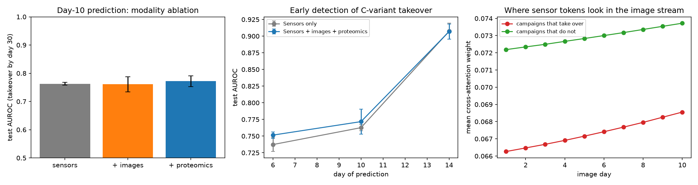

# P3 — Multimodal cross-attention model for early C-variant detection

**Question.** After *k* days of a 30-day campaign, can we predict whether a
colonial C-variant will take over the culture by fusing three data streams
sampled at very different rates? Does adding micrographs and proteomics to
process sensors actually help?

> Synthetic data, from the same 800 simulated campaigns as P2
> ([`fermsim/`](fermsim)). Each campaign has hourly sensors, one 32×32 hyphal
> micrograph per day, and 16-protein proteomics every 3 days with about 30% of
> samples missing. This was built in November 2026, with AI assistance, as
> preparation for a PhD application.

## Architecture

```
sensor 12 h patches ─ linear ─┐
daily images ──────── CNN ────┼─ + time embedding + modality embedding
proteomics samples ── MLP ────┘
   │
   ├─ 1. cross-attention: sensor tokens query [null | image | proteomics] tokens
   │     (a learned "null" token means attention always has somewhere to go when
   │      a modality is entirely missing)
   ├─ 2. 2-layer transformer fusion over [CLS | sensors | images | proteomics],
   │     with key-padding masks for missing samples
   └─ 3. heads: takeover logit (BCE) and final quality (MSE)
```

- **Irregular sampling:** every token gets a continuous time embedding (an MLP of hours ÷ 720), so streams with different rates share one time axis.
- **Missing data:** missing proteomics samples are masked, not imputed.
- **Modality dropout (p = 0.3):** during training, the whole image or proteomics stream is dropped at random, so the model learns not to depend on any one stream.
- **Evaluation:** the same chronological train/validation/test split as P2. Each configuration is run with 3 seeds.

## Results

**Day-10 modality ablation** (test set, mean ± std over 3 seeds):

| Inputs | Takeover AUROC | Quality MAE |
|---|---|---|
| Sensors only | 0.763 ± 0.005 | 24.3 ± 1.0 |
| Sensors + images | 0.761 ± 0.027 | 22.7 ± 1.6 |
| Sensors + images + proteomics | **0.772 ± 0.019** | 22.9 ± 1.0 |

**Robustness**: the full model trained with all three streams, tested with streams removed:

| Missing at test time | AUROC | Quality MAE |
|---|---|---|
| nothing | 0.772 | 22.9 |
| images | 0.765 | 22.8 |
| proteomics | 0.759 | 24.0 |
| images + proteomics | 0.750 | 23.9 |

**Early detection**: AUROC by day of prediction:

| Day | Sensors only | All three |
|---|---|---|
| 6 | 0.737 ± 0.010 | **0.751 ± 0.005** |
| 10 | 0.763 ± 0.005 | 0.772 ± 0.019 |
| 14 | 0.907 ± 0.012 | 0.907 ± 0.011 |



## What the results show

1. **The extra modalities add little, and most of the difference is within seed noise.** The only gain that is consistent across seeds is at day 6 (+0.014 AUROC). By day 14 the sensors alone already reach 0.91 and the other streams add nothing. This is a negative result, reported as such.
2. **The reason is signal size, not the fusion architecture.** At day 10 the average C-variant fraction is about 4.5%. P4 shows that even a dedicated CNN on 64×64 images struggles to separate C-fractions below 0.15 from those just above it. Here each day gets a single 32×32 image, which is even less information. The P2 oracle shows that the outcome *is* largely determined by day 5. The information exists, but none of these simulated measurements captures it early enough.
3. **Modality dropout works as intended.** With both extra streams removed at test time, the full model falls back to about sensor-only performance (0.750 vs 0.763). It degrades gracefully instead of failing, which matters in a real plant where proteomics are often late or missing.
4. **The cross-attention weights carry no content information.** They are close to uniform (about 1/14 across 14 memory tokens) and rise smoothly and linearly with image day for every campaign. That pattern comes from the time embedding, not from what the images show. Raw attention weights are not explanations. A real attribution study would use ablations, or gradient-based attribution such as integrated gradients, and test whether removing the "attended" images changes the prediction.

## What I would do next

- **Make each measurement more informative**, rather than adding more fusion layers: higher-resolution images, several fields per sample, and proteins chosen as early markers of the variant. In the simulator, the C-fraction enters each protein as one of five latent factors, scaled ×5, with per-protein noise of standard deviation 0.5. At a C-fraction of 0.045 that signal (about 0.22) sits below the noise.
- **Pre-train the image encoder** separately, using P4's CNN or self-supervised learning on micrographs, instead of learning it from 480 labelled campaigns.
- **Change the question:** predict the *time to takeover* with a survival model, which uses information from campaigns that haven't been taken over yet, instead of a binary label at day 30.
- Test properly whether the day-6 gain is real, with more seeds and a paired test.

## Run

Python 3.12, CPU only.

```bash
pip install -r requirements.txt
python scripts/generate_data.py               # once
python train.py        # about 1–3 h on a CPU (21 training runs)
```

## Part of a four-project series

These four projects share one simulated fermentation process: a chemostat with a colonial C-variant, plant drift, and sensor, micrograph and proteomics data. Each project's results motivate the next, and together they point towards hybrid mechanistic–ML models. References to P1–P4 in this README mean:

| | Project |
|---|---|
| P1 | [Physics-informed neural network for fermentation kinetics](https://github.com/GHUSER/pinn-fermentation-kinetics) |
| P2 | [Early quality prediction with conformal intervals](https://github.com/GHUSER/fermentation-quality-forecasting) |
| P3 | [Multimodal cross-attention for C-variant detection](https://github.com/GHUSER/multimodal-cvariant-detection) (this repository) |
| P4 | [Morphology CNN with Grad-CAM](https://github.com/GHUSER/hyphal-morphology-cnn-gradcam) |
